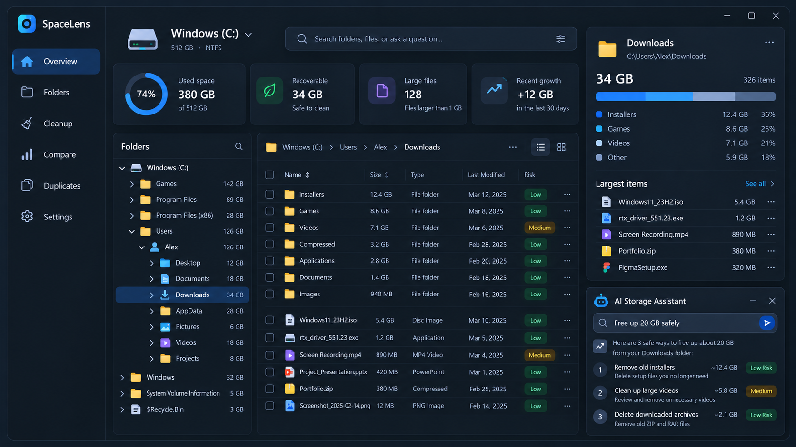

# SpaceLens

A native Windows storage manager: it scans a drive in seconds, shows where the space went in a folder hierarchy, finds what is safe to clean, and lets you ask **Claude Haiku 5.5** about your storage.

Built with **C# 13, .NET 9, WPF/XAML, CommunityToolkit.Mvvm, Microsoft.Extensions.DependencyInjection, SQLite and Windows DPAPI**. No browser, web server, Node or Rust. Scanning, the explorer, cleanup planning, history and duplicates all work offline; only Claude requests need the internet.



## Quick start

Double-click **`run.cmd`**. It builds SpaceLens when needed (with the .NET 9 SDK, or Docker if the SDK isn't installed) and starts it: the first time, and again whenever a file under `src` changed since the last build, so it always opens the newest version. `run.cmd --rebuild` builds even when nothing changed.

## Send it to someone

Double-click **`package.cmd`**. It builds `dist\SpaceLens.zip` (about 60 MB) with:

* `SpaceLens.exe`: self-contained, so the other PC needs nothing but Windows 10 or 11 (64-bit);
* `Install SpaceLens.cmd`: installs it for that Windows user, with no administrator rights: a copy in `%LOCALAPPDATA%\Programs\SpaceLens`, desktop and Start menu shortcuts, "Analyze with SpaceLens" in File Explorer's right-click menu and an entry in Settings › Apps (whose Uninstall removes all of it again, keeping scan history and settings);
* `README.txt` with those steps for the recipient.

They unzip it and double-click `Install SpaceLens.cmd`; SpaceLens opens and its shortcut is on the desktop. `SpaceLens.exe` also runs without installing, and can install itself later from Settings. The build isn't code-signed, so Windows SmartScreen may ask them to confirm (More info › Run anyway).

## Build, run, test, publish

Requires Windows 10/11 and the .NET 9 SDK. From the repository root:

```powershell
dotnet restore SpaceLens.sln
dotnet build SpaceLens.sln -c Release
dotnet run --project src/SpaceLens/SpaceLens.csproj
dotnet test SpaceLens.sln -c Release

# Self-contained portable build (no .NET runtime needed on the target PC)
dotnet publish src/SpaceLens/SpaceLens.csproj -c Release -r win-x64 --self-contained true -p:PublishSingleFile=true -p:IncludeNativeLibrariesForSelfExtract=true -p:EnableCompressionInSingleFile=true -o artifacts/publish/win-x64

# Small framework-dependent build (needs the .NET 9 Desktop Runtime)
dotnet publish src/SpaceLens/SpaceLens.csproj -c Release -r win-x64 --self-contained false -o artifacts/publish/win-x64-fdd
```

Run `artifacts/publish/win-x64/SpaceLens.exe`.

### Build in Docker

No .NET SDK on the machine? The `Dockerfile` builds the whole solution in a Linux container (with the same analyzers and warnings-as-errors rules) and exports the self-contained Windows executable:

```powershell
docker build --output artifacts/docker .
artifacts/docker/SpaceLens.exe
```

SpaceLens is a WPF desktop app, so it runs on the Windows desktop, not inside a container; the container is a reproducible build environment. The tests use DPAPI and the Windows file system, so run them on Windows with `dotnet test`.

UI smoke test (drives the real window through UI Automation after a Debug build):

```powershell
dotnet build SpaceLens.sln
powershell -ExecutionPolicy Bypass -File scripts/SmokeTest.ps1
```

Command-line switches for demos and automation: `--scan <path>`, `--select <path>`, `--page <Overview|Folders|Cleanup|Apps|SystemSpace|Duplicates|Compare|History|Settings>`, `--ask "<question>"`, `--capture <file.png>` (saves a screenshot and exits). Windows uses `--check` (the scheduled daily check), `--install`, `--uninstall` and `--welcome`.

## What it does

| Page | |
|---|---|
| **Overview** | Drive usage ring, low-risk recoverable space, files over 1 GB, growth since the previous scan, the folder tree with recursive sizes, the item table (name, size, type, modified, cleanup risk), a details panel with a storage breakdown and largest files, and the assistant. |
| **Folders** | The same explorer with more room. Breadcrumbs, up, filters (folders, files, > 1 GB, cleanup candidates), sorting on every column, search across the whole scan, multi-select with check boxes, context menus. **List or Map**: the map shows the folder as tiles sized by the space they use and colored by file type, with big folders' contents nested inside (click selects, double-click opens). Items can be **moved to another drive** (File Explorer's own copy window; frees the space here, loses nothing) or marked **Never suggest for cleanup**. |
| **Cleanup** | The **Storage Goal Solver**: enter "20 GB" and it builds the lowest-risk plan — whole low-risk groups first, then only as many reviewable items as the goal needs. High-risk and protected items are never used. |
| **Apps** | Installed programs (the same list as Settings › Apps) with their size — measured from the scan when it covers the app's folder — and when each was last started from Start, the taskbar or File Explorer (Windows' UserAssist record). Uninstall runs the app's own uninstaller after a confirmation. |
| **System space** | What Windows keeps for itself on the system drive: hibernation file, page file, previous Windows installation, update downloads, component store, restore points. Each card explains the trade-off and opens the Windows tool that shrinks it safely (powercfg, Temporary files, DISM, System Protection); SpaceLens never deletes any of it. |
| **Duplicates** | Same size → first/last 64 KB fingerprint → full SHA-256. Hard links aren't counted as duplicates; system and app files are left out. |
| **Compare** | Any two saved scans of the same location: folders that grew or shrank (only the most specific folders, so `C:\Users` isn't repeated when `Videos` explains it), and new large files. |
| **History** | Everything SpaceLens moved to the Recycle Bin or to another drive, with how much was cleaned up this month and overall. |
| **Settings** | Anthropic API key (masked, DPAPI-encrypted), connection test, consent; never-touch folders; daily low-space alerts; install and the right-click menu; data folder, history reset. |

**Daily alerts.** Turning them on creates a Windows scheduled task (current user, no administrator rights) that runs `SpaceLens.exe --check` around noon, or soon after the PC starts if it was off. The check looks for drives below the chosen free-space share and scans the system drive to compare it with its previous scan; only when something needs attention does a card appear in the corner of the screen.

### Scanner

* Parallel directory walk (up to 8 workers) into a compact in-memory tree. A full `C:` drive with ~390,000 files scans in about 1.5 s warm; the previous version wrote every file to SQLite and took minutes.
* Junctions, symbolic links and mount points are recorded but never followed (no loops, no double counting). OneDrive placeholders are scanned; cloud-only files count as 0 bytes on this PC.
* Access-denied folders are marked "No access" and counted, not guessed. Cancelling keeps a clearly labelled partial result.
* Sizes are **logical** file sizes in binary units like File Explorer (1 GB = 1,073,741,824 bytes). The usage ring uses Windows' **physical** numbers; for a whole-drive scan the details panel explains any difference (system files, unreadable folders, hard links, compression).

### Cleanup risk

Every item gets **Low Risk**, **Review Required**, **High Risk** or **Protected**, with a reason:

* **Protected** — Windows, Program Files, ProgramData, page/hibernation files, recovery and boot folders, links, Windows upgrade leftovers (cleaned through Settings › Storage instead).
* **High Risk** — the Users folder, your profile, AppData as a whole and app data inside it, hidden tool folders in your profile (`.vscode`, `.local`, …), main personal folders themselves, databases, mailboxes, virtual disks, program files, `.git`.
* **Low Risk** — temp files older than two days, browser and app caches, package-manager caches, crash dumps, installers in Downloads older than two weeks, the Recycle Bin.
* **Review Required** — everything else; size alone never makes a file unnecessary.

Folders on the **never-touch list** (Settings, or right-click › Never suggest for cleanup) count as Protected, with everything inside them.

Nothing is removed automatically. Removal always goes through a confirmation that lists the items, re-checks every item's risk (protected and high-risk items are dropped), and uses the **Recycle Bin**, so it can be undone. Emptying the Recycle Bin is a separate, explicitly confirmed step. Every removal or move is written to the cleanup history.

## Claude Haiku 5.5

Open **Settings › AI Assistant**, paste an Anthropic API key and **Save key**, then **Test connection**. The key is encrypted with Windows DPAPI (current user, with app-specific entropy) in `%LOCALAPPDATA%\SpaceLens\anthropic.key.dpapi`; it is never stored in plain text, logged or shown again (only its last four characters).

* Model `claude-haiku-5-5` via `POST https://api.anthropic.com/v1/messages` (`x-api-key`, `anthropic-version: 2023-06-01`) with plain `HttpClient`.
* Errors are reported separately for authentication (401), billing/credits (402 or low balance), permissions (403), model access (404), rate limits (429, retried using `retry-after`), overload (529), server errors, timeouts and network failures. When Claude can't be reached the assistant falls back to an offline answer.
* **Consent first:** before the first Claude request the assistant asks to share scan details (or set it in Settings). Without a key or consent, it answers offline from the scan.
* **Only what's needed:** each question carries a compact scan summary (totals, the selected item, biggest folders and files, cleanup groups, recent growth). Claude explores further with seven read-only tools — `list_folder`, `find_large_files`, `search_scan`, `get_item_details`, `plan_cleanup`, `compare_with_previous_scan`, `list_installed_apps`. File contents are never sent. File names are treated as data, never as instructions.
* Answers **stream in** as Claude writes them (server-sent events, rebuilt into the same message the tool loop needs).
* Answers cite items as `[[full path]]`, which become clickable links into the explorer; cleanup plans appear as numbered steps with risk badges, with **Clean these now…** (the usual confirmation, then the Recycle Bin) and a link to open the plan on the Cleanup page. Claude itself can't delete anything.
* The conversation as shown is kept in `chat.json`, so it's still there after a restart (the last 100 messages; Clear removes it).

## Architecture

Two production projects with a one-way dependency, plus tests:

| Project | Depends on | Holds |
|---|---|---|
| `SpaceLens.Core` (class library, no WPF) | .NET, SQLite, Microsoft.Extensions.* | Domain model, scanning, risk rules, cleanup planning and execution, history, duplicates, DPAPI credentials, the Claude client and tool loop. Everything a test can run without a window. |
| `SpaceLens` (WPF app) | `SpaceLens.Core`, CommunityToolkit.Mvvm | Views, view models, converters, controls, and the Windows-only adapters Core asks for (confirmation dialogs, folder picker, File Explorer and clipboard). |
| `SpaceLens.Tests` (xUnit) | both | 148 tests: Core services against fakes and temp folders, plus view-model behaviour (consent, duplicate safety, plan selection, recycle targets), streamed answers, never-touch folders and the map layout. |

Rules the code follows:

* **Dependency injection everywhere.** `AddSpaceLensCore()` registers Core; `AddSpaceLensApp()` adds the WPF layer. Services depend on interfaces (`IDiskScanner`, `ICleanupExecutor`, `IScanSession`, `IConfirmationService`, …) and the container validates the graph on start.
* **Core never shows UI.** When it needs the user (confirming a removal) it calls `IConfirmationService`, which the app implements with a dialog and tests implement with a script.
* **One shared, locked scan.** `IScanSession` owns the current tree; background readers and removals go through one gate, so a recycle never changes the tree under a running query.
* **View models hold no business rules.** They call Core services and turn results into display state. Each page is its own view model; `MainViewModel` only composes them. Cross-page events use `IMessenger` messages.
* **Errors are typed at the boundary.** The Claude client throws `AiServiceException` with a kind (auth, billing, rate limit, …); history failures surface as `HistoryStoreException`; shell failures as `InvalidOperationException` with a user-facing message. Logging goes through `ILogger<T>` and never includes the API key.
* **Style is enforced by the build.** `Directory.Build.props` turns on nullable reference types, the latest analyzers and code-style checks, and treats every warning as an error; `.editorconfig` sets naming (`_camelCase` fields, `I` interfaces, PascalCase constants), file-scoped namespaces, braces and unused-using checks. One type per file.

## Project layout

```text
SpaceLens.sln
Directory.Build.props               shared compiler, analyzer and versioning settings
.editorconfig                       formatting and naming rules (checked during build)
references/ui-reference.png         design reference
scripts/SmokeTest.ps1               UI Automation smoke test
scripts/MakeIcon.ps1                makes Assets\SpaceLens.ico (exe and desktop icon) from the in-app logo
run.cmd / package.cmd               start the newest build / make dist\SpaceLens.zip to send to someone
packaging/                          what goes in the zip besides SpaceLens.exe (installer script, README)
src/SpaceLens.Core/
  Configuration/                    AppPaths (%LOCALAPPDATA%\SpaceLens)
  DependencyInjection/              AddSpaceLensCore()
  Interop/                          every P/Invoke declaration (NativeMethods) and reparse-point helpers
  Models/                           FolderNode/FileNode tree, scan result, risk, cleanup, history, AI records
  Repositories/                     SQLite scan history (versioned schema)
  Services/
    Scanning/                       DiskScanner, ParallelDirectoryWalker, DriveService, FileTypeClassifier, StorageAnalyzer
    Cleanup/                        KnownLocations, CleanupCatalog, risk analyzer, analyzer, planner, executor, Recycle Bin, moves, cleanup log
    Apps/                           installed programs (registry + UserAssist), uninstall command lines
    SystemSpace/                    hibernation, page file, Windows.old, update downloads, WinSxS
    Alerts/                         the daily low-space and growth check
    Integration/                    right-click menu, shortcuts, Apps-list entry, scheduled task
    AI/                             Messages API client, Claude Haiku service + tool loop, context builder, tools, offline assistant
    Storage/                        history service (growth, comparisons)
    Duplicates/                     DuplicateFinder
    Security/                       DPAPI credential store
    Settings/                       JSON settings
    Session/                        IScanSession (current scan + derived data)
    Interaction/                    IConfirmationService (implemented by the app)
src/SpaceLens/
  App.xaml(.cs)                     startup, resources, DI container, unhandled-error logging
  Infrastructure/                   AddSpaceLensApp(), converters, startup switches, window capture, installer, app icons
  Services/                         dialogs, folder picker, alert card, shell (File Explorer, clipboard, Settings), saved chat
  ViewModels/                       one view model per page or panel; Messages/ for IMessenger messages
  Views/                            WPF views; code-behind only for view behaviour
  Controls/                         RingGauge, ChatText (formatted answers with links), StorageMap + SquarifiedLayout (the map)
  Resources/                        colours, control styles, data views, icons
tests/SpaceLens.Tests/              xUnit tests; Support/ holds fakes and factories
archive/                            superseded Tauri scaffold and the previous WPF version
```

## Data on disk

`%LOCALAPPDATA%\SpaceLens\` holds `scans.db` (folders of 1 MB+ and files of 100 MB+ per completed scan; 12 scans kept per location), `settings.json` (consent, never-touch folders, alert thresholds), `cleanup-log.json` (the History page, last 500 actions), `chat.json` (the assistant conversation as shown) and the encrypted key. Installing adds `%LOCALAPPDATA%\Programs\SpaceLens\SpaceLens.exe`, two shortcuts and keys under `HKCU\Software` (right-click menu, Apps-list entry); the daily check is the scheduled task "SpaceLens daily check". Scan history from the previous version used an incompatible schema and is reset on first start; a key saved by the previous version has to be entered again.

## Limits

Logical sizes, not allocated clusters. Hard links are counted once per name. Scans are not atomic snapshots of a changing disk. Folders Windows won't let you read are reported, not estimated. Not code-signed. "Last used" for apps only covers programs started from Start, the taskbar or File Explorer. On Windows 11 the right-click entry is under Show more options.
